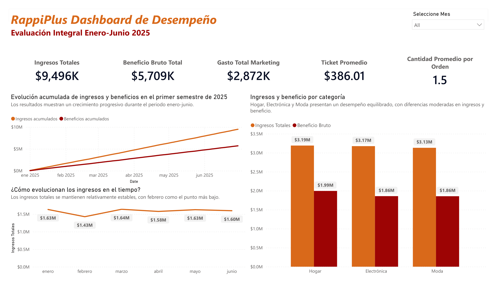
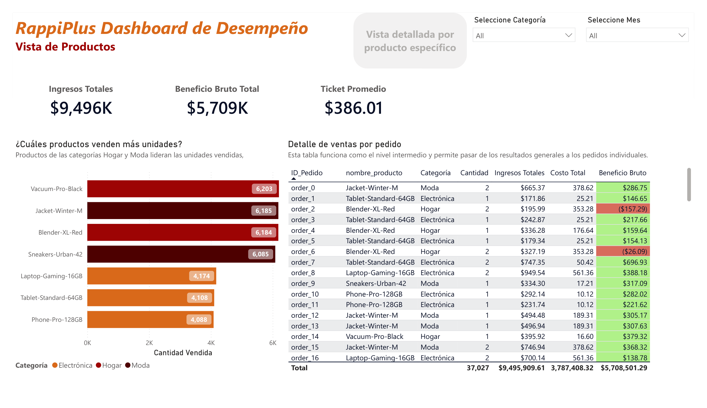
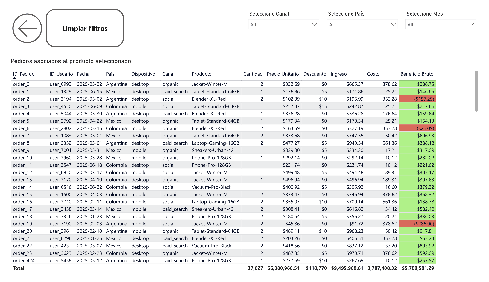

# RappiPlus Business Performance Analysis

This project evaluates the business performance of RappiPlus through sales, profitability, marketing, user behavior, retention, and checkout conversion analysis.

The project combines Python, SQL, statistical testing, and Power BI to transform raw business data into actionable insights.

---

## 📌 Project Overview

The analysis follows the business journey from data quality assessment to profitability, conversion, retention, experimentation, and business intelligence reporting.

The final results are consolidated into an interactive Power BI dashboard designed to support performance analysis at both executive and product/order levels.

---

## 🏢 Business Context

RappiPlus needs to understand its commercial performance and identify opportunities to improve customer conversion and retention.

The analysis focuses on profitability, purchase funnel performance, user retention, and whether a checkout UI change generated a measurable impact on conversion.

---

## 🎯 Analysis Objective

### Main Objective

Evaluate RappiPlus business performance and identify the main opportunities for improving profitability, conversion, and user retention.

### Analysis Questions

- Is RappiPlus profitable after product costs and marketing investment?
- Where are the largest losses in the purchase funnel?
- How does user retention evolve during the first four weeks?
- Did the checkout UI change significantly improve purchase conversion?

---

## 📊 Data Sources

| Source | Description |
|---|---|
| `rappiplus_orders_raw.csv` | Order-level information including products, prices, discounts, quantities, and revenue. |
| `rappiplus_catalog.csv` | Product information and unit costs used to calculate profitability. |
| `rappiplus_marketing_spend.csv` | Marketing investment by channel and country. |
| `events` | User events used to construct the purchase funnel. |
| `users` | User registration data used for cohort analysis. |
| `user_activity` | User activity data used to calculate retention. |
| `experimento.csv` | Checkout experiment data used for statistical testing. |

The sales, cost, and marketing analysis covers **January–June 2025**. The SQL analyses use data from the same analytical period where applicable.

---

## 🔎 Analysis Process

- **Data quality assessment:** identified missing values, duplicates, invalid dates, inconsistent categories, and anomalous numerical values.
- **Data cleaning and standardization:** corrected data types, standardized categorical values, removed invalid records, and addressed extreme quantity values.
- **Business performance analysis:** integrated order and catalog data to calculate revenue, costs, gross profit, net profit, and commercial KPIs.
- **User behavior analysis:** used SQL to construct a sequential conversion funnel and cohort-based retention analysis.
- **Statistical analysis:** applied a two-proportion z-test to evaluate the checkout UI experiment.
- **Business intelligence:** consolidated the main commercial results into an interactive Power BI dashboard.

---

## 🔑 Key Findings

### 💰 RappiPlus operates profitably

Revenue reached **9.50M UM**, with **3.79M UM** in product costs and **2.87M UM** in marketing investment. After both expenses, net profit reached **2.84M UM**, resulting in **42.60% profitability** relative to total costs and marketing investment.

### 🛒 Checkout contains the main conversion opportunity

The sequential funnel decreased from **7,796 first-time visitors to 3,857 purchases**, resulting in a **49.47% overall conversion rate**.

The largest drop-off absolute occurred between `begin_checkout` and `add_payment_info`, where **1,397 users** were lost. The largest relative drop-off occurred between `add_payment_info` and `purchase`, at **22.35%**.

### 🔁 User retention declines substantially after registration

Retention decreased from approximately **85–87% in week 1** to **40–41% in week 4**, meaning RappiPlus retained roughly **40% of the initial user base after the first month**.

### 🧪 The checkout UI change did not produce a statistically significant improvement

Conversion increased from **15.69%** in the control group to **16.29%** in the treatment group.

However, the two-proportion z-test produced a **p-value of 0.416**, so the observed **0.60 percentage-point increase** was not statistically significant.

### 📊 Business performance can be explored interactively

The Power BI dashboard connects executive KPIs with product-level and order-level analysis, allowing users to move from overall performance to detailed commercial records.







---

## 💡 Recommendations

- **Investigate the final checkout stages**, particularly the transition from payment information to completed purchase, where conversion losses are concentrated.
- **Develop retention initiatives** aimed at maintaining user activity beyond the first month.
- **Continue checkout experimentation** rather than treating the tested UI change as a proven conversion improvement.
- **Monitor marketing efficiency** alongside profitability, since marketing investment represents a significant component of total costs.

---

## ⚠️ Analysis Limitations

- The SQL analyses rely on a private PostgreSQL database from the academic environment; database credentials and connection details are excluded from the repository.
- Some users appear in later funnel events without records of previous events, which may indicate alternative user paths or missing event records.
- Extreme quantities for `Laptop-Gaming-16GB` required a conservative correction because there was no additional information available to validate those transactions.
- The A/B test did not provide statistically significant evidence of an improvement in conversion.

---

## 🗂️ Repository Structure

```text
RappiPlus_Business_Performance_Analysis/
│
├── README.md
│
├── dashboard/
│   └── rappiplus_dashboard.pbix
│
├── data/
│   ├── clean/
│   │   ├── catalog_clean.csv
│   │   ├── marketing_clean.csv
│   │   └── orders_clean.csv
│   │
│   └── raw/
│       ├── experimento.csv
│       ├── rappiplus_catalog.csv
│       ├── rappiplus_marketing_spend.csv
│       └── rappiplus_orders_raw.csv
│
├── images/
│   ├── dashboard_details.png
│   ├── dashboard_drillthrough.png
│   └── dashboard_overview.png
│
└── notebook/
    └── rappiplus_business_performance_analysis.ipynb
```

---

## 🛠️ Tools and Technologies

* Python: Pandas, Seaborn, Matplotlib, Statsmodels
* ETL & EDA
* SQL
* Statistical Analysis: Two-proportion z-test
* Business Intelligence: Power BI
  * Power Query
  * Basic Data Modeling (Table Relationships)
  * Dashboard Layout and Design with core charts (Bar, Line, Column, Cohorts)
  * Calculated Columns and Tables
  * Measures

---

## 👤 Author

**Edgar Rojas**

*Data Analytics Portfolio Project*
